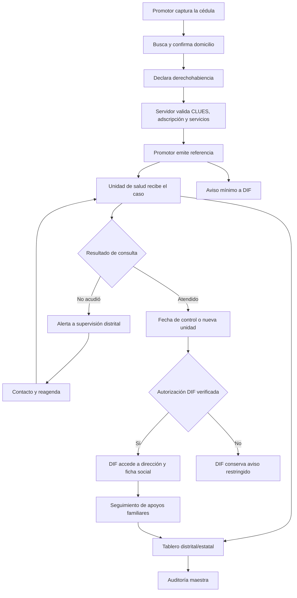

# Nutriendo Futuros · Red Multinivel de Atención (NFM) · v0.1

**Frase de identidad:** Un expediente, un folio, un futuro.
**Estado de entrega:** maqueta navegable y lógica de transición demostrativa, con documentación y SQL **preparatorio NO ejecutado**. Toda la simulación usa registros sintéticos. No está vinculada todavía al proyecto Supabase de producción.

## Sistemas existentes inspeccionados

Proyecto existente: `doctopanda/nutriendo-futuros` (GitHub Pages) y Supabase Nutriendo Futuros. La base ya cuenta con `nf_private.pacientes`, `nf_private.seguimientos`, `nf_private.referencias`, `nf_private.auditoria`, `nf_private.clues_autorizadas`, `nf_private.hospitales_referencia`, `nf_private.perfiles` y funciones públicas `nf_registrar_cedula`, `nf_guardar_referencia`, `nf_actualizar_referencia`, `nf_listar_referencias`, `nf_linea_tiempo`.

**Advertencia de compatibilidad:** Los roles actuales en `nf_private.perfiles` y en el ENUM `public.nfs_usuarios.rol` se limitan a `promotor_salud`, `supervisor_distrital`, `admin_estatal`, `admin_maestro`. El RPC existente `nf_actualizar_referencia` permite actualizaciones por promotores/administradores, pero **NO** tiene rol de unidad receptora. No ampliar ese RPC sin pruebas de autorización. La propuesta agrega la tabla de asignaciones `nfm_asignaciones_institucionales`, sin alterar el ENUM vigente.

## Flujos propuestos

## Estados y eventos

Los eventos no reemplazan la fila histórica de referencia. `nf_private.referencias` conserva la emisión y sus metadatos. `nf_private.nfm_eventos_referencia` agrega eventos de consulta y agenda. El estado visible se deriva del evento más reciente, pero **haber sido atendido** se calcula mediante la existencia de un evento `ATENDIDA_NUEVA_CITA` o `ATENDIDA_DERIVADA` válido, no por una cita reagendada. Puede haber múltiples referencias por paciente en la vida del expediente.

| Evento | Actor permitido | Condición | Resultado |
|---|---|---|---|
| REFERENCIA_EMITIDA | Promotor autorizado | Cédula válida + destino CLUES aprobado | Se crea referencia, aviso DIF no nominal y tarea unidad |
| CITA_CONFIRMADA | Unidad destino | Adscripción a CLUES de la referencia | Fecha firme o reprogramada |
| ATENDIDA_NUEVA_CITA | Unidad destino | Consulta documentada | Próximo control, desbloqueo DIF condicionado |
| ATENDIDA_DERIVADA | Unidad destino | Consulta documentada + CLUES 2ª unidad validada | Nueva referencia enlazada, auditoría |
| NO_ACUDIO | Unidad destino | Cita vencida/inasistencia confirmada | Alerta al distrito, no cierre automático |
| CONTACTO_DISTRITAL | Supervisor | Caso de su distrito | Bitácora de búsqueda/reagenda, sin falsificar consulta |
| SEGUIMIENTO_DIF | DIF autorizado | Atención clínica + autorización DIF vigente | Ficha social visible y actualizable |

**Urgentes:** no entran a la cola ordinaria como sustituto de una valoración inmediata. Mostrar protocolo de atención urgente y registrar referencia/transferencia siguiendo la red local aprobada.

## Matriz mínima de accesos

| Rol | Lectura de datos | Escritura | Lo que no debe ver |
|---|---|---|---|
| Promotor | Cédulas que capturó o le asignaron; respuestas a sus referencias | Captura, referencia, seguimientos permitidos | Pacientes ajenos sin asignación |
| Unidad de salud | Datos clínicos mínimos de referencias a su CLUES | Cita, atendido, nueva cita, derivación, no acudió | Expedientes de otras unidades y datos sociales DIF |
| DIF | Aviso del distrito (mínimo). Datos sociales y domicilio solo si ya atendido + autorización válida | Contacto social y caracterización de hogar | Cédula clínica completa y otros distritos |
| Supervisor distrital | Lista de pendientes de su distrito; detalle mínimo para localizar según competencia | Tareas de rastreo y seguimiento | Otros distritos y datos clínicos no necesarios |
| Admin estatal | Operación 6 distritos con justificación | Supervisión, conciliación y autorizaciones | Acceso sin motivo ni registro |
| Admin maestro | Gobierno de roles, bitácora y accesos excepcionalmente justificados | Gestión y auditoría | No exime de trazabilidad o minimización |

## Diseño API recomendado

### RPC que ya existen (verificadas en la base)

- `public.nf_registrar_cedula(p_documento jsonb)`: genera folio, seguimiento inicial; requiere que el cliente envíe identidad y consulta conforme al diccionario, con autorización clínica y CLUES validada.
- `public.nf_guardar_referencia(p_folio text, p_documento jsonb)`: registra destino CLUES y referencia; verifica CLUES antes de insertar.
- `public.nf_actualizar_referencia(p_id uuid, p_estado text, p_recepcion jsonb)`: limitada a roles actuales y estados definidos. **No usarla directamente para permitir a la unidad nuevas operaciones.**

### RPC nuevas a implementar y probar antes de conectar pacientes reales

1. `nf_nfm_mi_contexto()`: derivar sesión, rol, institución/distrito y consentimientos desde tablas del servidor. NUNCA desde el selector visual o `user_metadata`.
2. `nf_nfm_sugerir_unidades(p_distrito, p_derechohabiencia, p_lat, p_lon, p_prioridad)`: devuelve solo unidades verificadas, filtro por institución, convenio, pediatría/nutrición y capacidad; la distancia se calcula sobre unidades verificadas y se diferencia de adscripción.
3. `nf_nfm_emitir_referencia(p_folio, p_unidad, p_fecha, p_motivo, p_autorizacion)`: usa/compatibiliza RPC existente, transacción atómica, evento inicial y aviso DIF. El cliente jamás escribe en tablas privadas.
4. `nf_nfm_bandeja_unidad()`: mínima proyección de las referencias correspondientes a las CLUES asignadas al `auth.uid()`.
5. `nf_nfm_registrar_atencion(p_ref, p_evento, p_fecha, p_destino, p_nota)`: valida rol `unidad_salud`, destino, estado y repetición idempotente; agrega evento y auditoría.
6. `nf_nfm_bandeja_dif()`: entrega solo avisos del distrito autorizado y revela nombre de cuidadora únicamente cuando exista fundamento vigente. NUNCA dirección hasta evento de atención confirmado y autorización de acceso domiciliario.
7. `nf_nfm_ficha_dif(p_ref)`: comprueba autorización **actual** y atención anterior en cada llamada (no depende de bandera almacenada).
8. `nf_nfm_guardar_evaluacion_dif(p_ref, p_evaluacion)`: valida asignación DIF, acceso, límites y registra cambios auditables.
9. `nf_nfm_alertas_distrito(p_distrito)` / `nf_nfm_panorama_estado()`: columnas minimizadas y ámbito autenticado. Indicadores agregados sin filas nominales para vistas públicas.

No se deben publicar RPC `SECURITY DEFINER` antes de auditar, revocar EXECUTE a `PUBLIC`/`anon`, validar `auth.uid()` y documentar pruebas de acceso cruzado. La nueva SQL **preparatoria** no crea RPC ni da permisos a clientes.

## Geocodificación tipo app de transporte

1. Promotor escribe calle y colonia. Un proveedor especializado en autocompletado devuelve **sugerencias** (Google Places Autocomplete New, o servicio propio Pelias/Photon con datos OSM y controles internos).
2. Al elegir sugerencia se recibe identificador de lugar, dirección y coordenadas; el promotor valida sobre mapa y corrige números/interiores sin forzar un match.
3. El motor de referencia cruza la coordenada validada con municipio, distrito, **derechohabiencia**, adscripción, cartera de servicios, nivel de atención, CLUES activa y capacidad confirmada. Se muestran candidatos con motivo de elegibilidad. Nunca adjudicar por cercanía exclusivamente.
4. Si el proveedor no reconoce un domicilio rural: ubicación manual del punto + referencia de acceso, sin errores silenciosos ni sobreescritura de coordenadas.
5. El contrato de geocodificación y el aviso institucional de privacidad deben permitir ese uso. No enviar a un proveedor externo los nombres ni diagnósticos junto con la dirección. Debe existir una alternativa sin terceros.

**No usar la instancia pública de Nominatim para autocomplete**, ya que prohíbe ese uso explícitamente. Referencias: https://operations.osmfoundation.org/policies/nominatim/ ; https://developers.google.com/maps/documentation/places/web-service/place-autocomplete

## INEGI y composición del hogar

- **Información disponible:** datos censales agregados por manzana/AGEB/localidad/municipio (según indicador y restricción), población por grupos de edad y viviendas. Útiles como contexto territorial con fuente y año.
- **Información NO disponible públicamente a nivel domicilio individual:** cuántos menores o adultos mayores concretos habitan una dirección, quién sostiene económicamente ese domicilio o identidad de sus residentes.
- **Captura DIF:** el módulo obtiene cifras exactas mediante entrevista/visita autorizada, con fecha, procedencia y persona responsable. No presentar promedios censales como verdades sobre un hogar.
- **Uso cartográfico:** residencia de una familia jamás aparece en el mapa público; la difusión de agregados se hace solo con supresión y revisión de reidentificación, no basta umbral numérico por sí solo.

Fuentes para explorar: API Banco de Indicadores INEGI `https://www.inegi.org.mx/servicios/api-indicadores/`, Catálogo CLUES oficial `https://gobi.salud.gob.mx/`, norma de catálogo CLUES NOM-035-SSA3-2012.

## Sincronización de carátulas (fase real)

**Supabase Postgres** concentra los datos y eventos. Las RPC autenticadas escriben transacciones y bitácoras. Cada vista usa bandejas específicas y consultas seguras. Sincronía entre sesiones mediante Realtime con suscripciones privadas por `user_id` y filtrado server-side, o actualizaciones periódicas autenticadas. **No transmitir detalles clínicos ni direcciones en payloads Broadcast**; entregar solo un token de invalidación de la bandeja para que el cliente vuelva a consultar la RPC bajo autorización vigente. Ante falla de Realtime, actualización manual o polling controlado. Revisar revocación de sesiones y JWT caducado.

## Plan de adopción

1. Aprobar flujos clínicos y acuerdos de intercambio (Salud, DIF, jurisdicciones, responsables de datos), aviso y formato oficial.
2. Levantar/validar catálogo CLUES con coordenadas, servicios, adscripción y disponibilidad por institución; directorio DIF/distrito.
3. Migrar esquema adicional en **staging**, pruebas de seis roles, acceso negativo, revocación y bitácora.
4. Crear RPC de lectura/escritura autorizadas y notificaciones privadas, y conectar carátulas reales a autenticación, no al selector demo.
5. Realizar piloto de pocos casos sintéticos, luego casos consentidos con pruebas en campo; medir oportunidad de referencia, fecha real de cita, atención, inasistencias, evaluación DIF y tiempo de cierre.

### Pruebas necesarias

- Usuario unidad A **no puede** leer referencia enviada a unidad B.
- DIF recibe aviso, pero **no dirección antes de atención** ni después si autorización fue revocada.
- Reagendar una cita sin consulta **no habilita** domicilio DIF.
- Un promotor no puede autootorgarse rol DIF o cambiar distrito desde el navegador.
- Un supervisor no puede modificar el diagnóstico escrito por la unidad.
- Una referencia clínica nueva genera exactamente un aviso institucional; reintentos no duplican eventos.
- Los dispositivos móviles no conservan PII al salir, tampoco caché del navegador ni consultas en URL.

**Importante:** la maqueta de `index.html` solo demuestra la experiencia y los cambios sincronizados dentro de la misma pestaña. No es una plataforma multiusuario real. El SQL está preparado para su revisión y NO fue aplicado a la base de producción.
